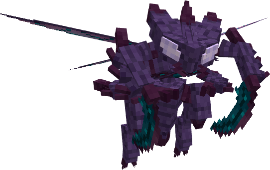
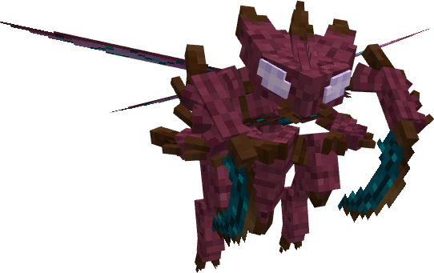
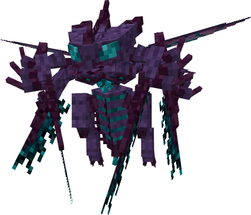
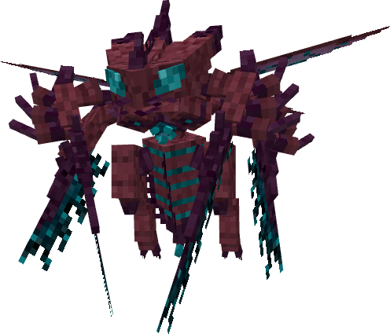

# 👾 Abyssect

**Abyssect** → **Mega-Abyssect** (Megaevolución)

**Ir a:** [Abyssect](abyssect.md#abyssect) · [Mega-Abyssect](abyssect.md#mega-abyssect)

***

## 1. Abyssect (Nº 2006)

### Información

**Abyssect** es un Pokémon de tipo [dragón](https://www.wikidex.net/wiki/Tipo_drag%C3%B3n)/[bicho](https://www.wikidex.net/wiki/Tipo_bicho) introducido en la **Temporada Glitch 👾**. Es conocido por ser un depredador implacable en el servidor **Universo PokéNet**.

|   **Artwork**   |                                                                                   |
| :-------------: | ------------------------------------------------------------------------------------------------------------------------------------------- |
|    **Tipos**    |                                     |
| **Habilidades** | 
<a href="https://www.wikidex.net/wiki/Enjambre">Swarm</a> <a href="https://www.wikidex.net/wiki/Intimidaci%C3%B3n">Intimidate</a>
 |
| **Hab. oculta** | **Abyssalcore** (Custom)                                                                                                                    |
| **Grupo Huevo** | [Bicho](https://www.wikidex.net/wiki/Grupo_bicho), [Dragón](https://www.wikidex.net/wiki/Grupo_drag%C3%B3n)                                 |
|  **Creado por** | xFuriadaNoitex                                                                                                                              |

<strong>Ver Aspecto Shiny:</strong>

 

### Forma Shiny

### Descripción (Lore)

**Abyssect:** Una manifestación de poder antiguo que combina la ferocidad de los dragones con la adaptabilidad de los insectos. Su núcleo abisal pulsa con una energía oscura que le permite ejecutar movimientos rápidos y letales, siendo una de las criaturas más temidas de su hábitat.

### Características base

Las [características base](https://www.wikidex.net/wiki/Caracter%C3%ADsticas) de Abyssect son las siguientes:

| Estadística   |     Distribución     |
| ------------- | :------------------: |
| **PS**        | **107** `█████████░` |
| **Ataque**    | **135** `██████████` |
| **Defensa**   |  **80** `██████░░░░` |
| **At. Esp**   |  **70** `██████░░░░` |
| **Def. Esp**  |  **85** `███████░░░` |
| **Velocidad** | **123** `██████████` |
| **TOTAL**     |        **600**       |

### Movimientos



| Nivel |                          Movimiento                         |                          Tipo                         | Nivel |                           Movimiento                          |                          Tipo                         |
| :---: | :---------------------------------------------------------: | :---------------------------------------------------: | :---: | :-----------------------------------------------------------: | :---------------------------------------------------: |
|   1   |        [Leer](https://www.wikidex.net/wiki/Malicioso)       |  |   48  | [Dragon Claw](https://www.wikidex.net/wiki/Garra_drag%C3%B3n) |  |
|   1   |     [Scratch](https://www.wikidex.net/wiki/Ara%C3%B1azo)    |  |   52  |                     **Abyssrend** (Custom)                    |  |
|   12  |  [Dragon Breath](https://www.wikidex.net/wiki/Dragoaliento) |  |   58  |         [Outrage](https://www.wikidex.net/wiki/Enfado)        |  |
|   30  |     [U-turn](https://www.wikidex.net/wiki/Ida_y_vuelta)     |    |       |                                                               |                                                       |
|   42  | [First Impression](https://www.wikidex.net/wiki/Escaramuza) |    |       |                                                               |                                                       |



|                           Movimiento                          |                             Tipo                            |                        Movimiento                       |                             Tipo                            |
| :-----------------------------------------------------------: | :---------------------------------------------------------: | :-----------------------------------------------------: | :---------------------------------------------------------: |
|         [Lunge](https://www.wikidex.net/wiki/Plancha)         |          |  [Night Slash](https://www.wikidex.net/wiki/Tajo_noche) |  |
|    [Sucker Punch](https://www.wikidex.net/wiki/Golpe_bajo)    |  | [Sticky Web](https://www.wikidex.net/wiki/Red_pegajosa) |          |
| [Dragon Rush](https://www.wikidex.net/wiki/Carga_drag%C3%B3n) |        |                                                         |                                                             |



|                         Movimiento                        |                          Tipo                         |                         Movimiento                         |                             Tipo                            |                           Movimiento                          |                          Tipo                         |
| :-------------------------------------------------------: | :---------------------------------------------------: | :--------------------------------------------------------: | :---------------------------------------------------------: | :-----------------------------------------------------------: | :---------------------------------------------------: |
| [Swords Dance](https://www.wikidex.net/wiki/Danza_espada) |  | [Iron Head](https://www.wikidex.net/wiki/Cabeza_de_hierro) |          |       [X-Scissor](https://www.wikidex.net/wiki/Tijera_X)      |    |
| [Draco Meteor](https://www.wikidex.net/wiki/Cometa_draco) |  |       [Crunch](https://www.wikidex.net/wiki/Triturar)      |  | [Tera Blast](https://www.wikidex.net/wiki/Teraexplosi%C3%B3n) |  |



***

## 2. Mega-Abyssect (Nº 2006)

### Información

**Mega-Abyssect** es la forma potenciada de [Abyssect](abyssect.md#abyssect). Su peso aumenta considerablemente a 120.0 kg y su escala visual crece para imponer su dominio en combate.

|   **Artwork**   |                                         |
| :-------------: | ----------------------------------------------------------------------------------------------------------- |
|    **Tipos**    |     |
|  **Habilidad**  | **Abyssalcore** (Custom)                                                                                    |
| **Grupo Huevo** | [Bicho](https://www.wikidex.net/wiki/Grupo_bicho), [Dragón](https://www.wikidex.net/wiki/Grupo_drag%C3%B3n) |
|  **Creado por** | xFuriadaNoitex                                                                                              |

<strong>Ver Aspecto Mega Shiny:</strong>

 

### Forma Mega Shiny

### Descripción (Lore)

**Mega-Abyssect:** La energía de la megaevolución ha sobrecargado su núcleo abisal, otorgándole una fuerza física capaz de desgarrar dimensiones. Su armadura de quitina se refuerza y sus alas vibran a una frecuencia que intimida a cualquier oponente, convirtiéndolo en el máximo exponente de su línea evolutiva. Su naturaleza bicho se vuelve más errática y agresiva.

### Características base

Tras la megaevolución, sus [características base](https://www.wikidex.net/wiki/Caracter%C3%ADsticas) aumentan significativamente:

| Estadística   |     Distribución     |
| ------------- | :------------------: |
| **PS**        | **107** `█████████░` |
| **Ataque**    | **165** `██████████` |
| **Defensa**   | **100** `████████░░` |
| **At. Esp**   |  **90** `███████░░░` |
| **Def. Esp**  |  **95** `████████░░` |
| **Velocidad** | **143** `██████████` |
| **TOTAL**     |        **700**       |

### Movimientos

_Mega-Abyssect mantiene el acceso a todos los movimientos de su forma base, potenciando su efectividad gracias a su incremento masivo en Ataque y Velocidad._



|                          Movimiento                         |                          Tipo                         | Descripción                                                                  |
| :---------------------------------------------------------: | :---------------------------------------------------: | ---------------------------------------------------------------------------- |
|                    **Abyssrend** (Custom)                   |  | Movimiento característico potenciado por su nueva forma.                     |
| [First Impression](https://www.wikidex.net/wiki/Escaramuza) |    | Ideal para golpear primero con una fuerza devastadora de 165 de Ataque base. |
|  [Swords Dance](https://www.wikidex.net/wiki/Danza_espada)  |  | Permite alcanzar niveles de daño insuperables en pocos turnos.               |


