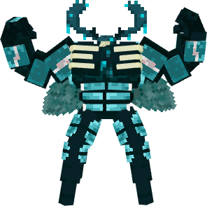
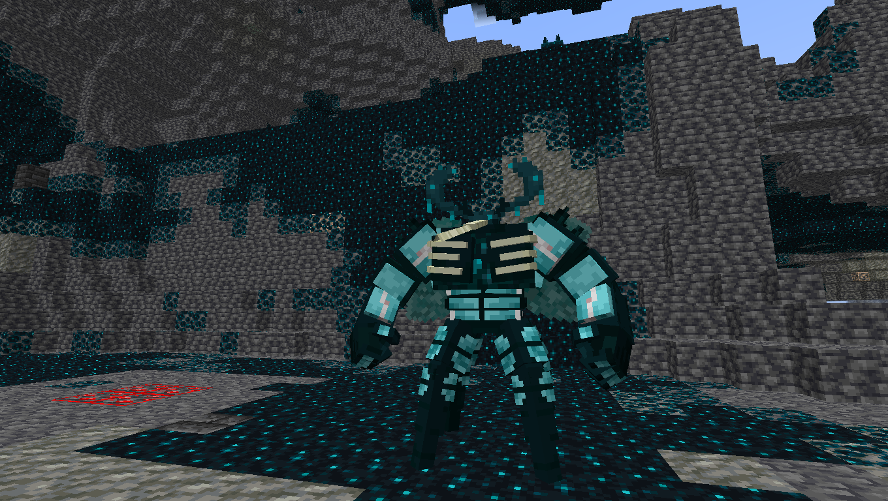

# 🗝️ Buzzwole Warden

## Información

**Buzzwole Warden** es una Skin exclusiva del servidor Cobblemon introducida en la [PokéNightmares](./).

|             |                                                                |
| ----------: | -------------------------------------------------------------- |
| **Artwork** |  |
|  Creado por | YamatoDust                                                     |

### Comentario del desarrollador

La creación de esta skin hace referencia al un monstruo hostil ciego del juego **Minecraft**.

## Obtención

Esta skin se consigue en el Gatcha temporal de **PokéNightmares 2025**.
